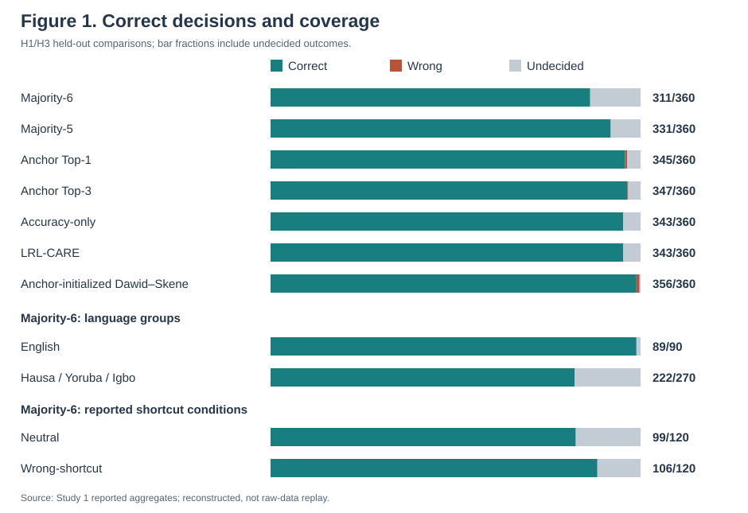
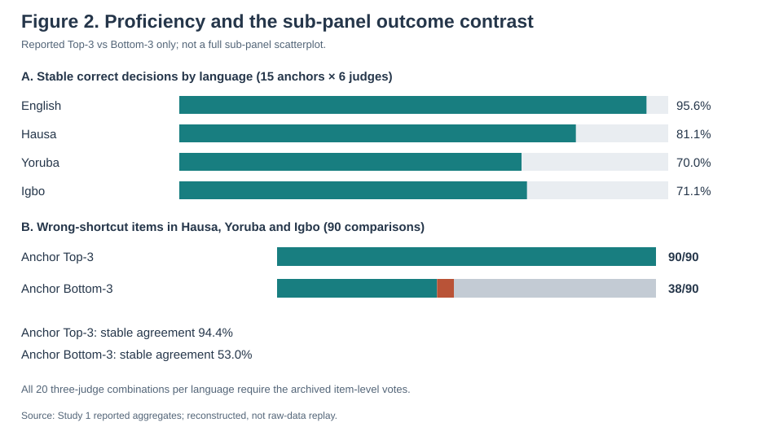
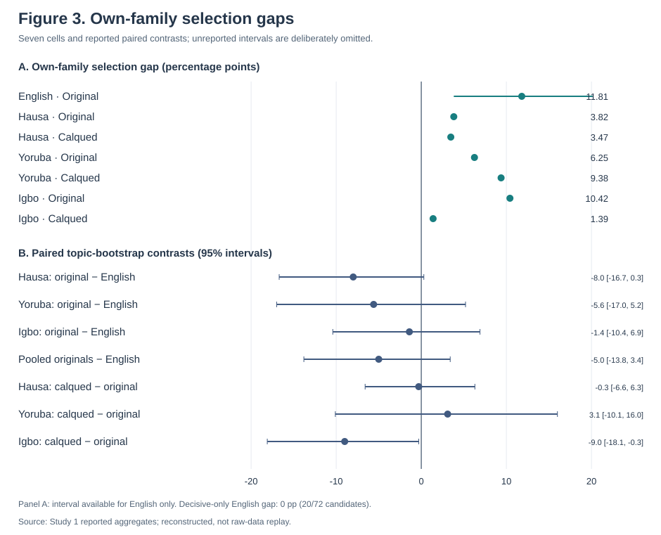

# Beyond Condorcet’s Jury Theorem: Testing Proficiency–Consensus Inversion, Coverage Collapse, and Own-Family Preference in Multilingual LLM Judge Panels

**Study 1 — working manuscript (reconstructed from the reported results)**

Jeremiah Adepoju — author list and affiliations to be confirmed.

## Abstract

Cross-family panels of large language model (LLM) judges are often used to reduce individual evaluator biases. Whether panel aggregation is reliable in low-resource languages depends on both the correctness and the stability of individual judgments. We evaluate six model families across English, Hausa, Yoruba and Igbo using a unified study comprising 672 response comparisons and 8,064 order-counterbalanced judge calls. Independent language-specific anchor items yield stable correct-vote rates of 95.6% in English and 70.0–81.1% in the three African languages. Contrary to the proposed proficiency–consensus inversion, lower-ranked judges exhibit weaker agreement rather than stronger erroneous consensus. A strict six-judge majority produces no wrong majority decisions on 360 verifiable held-out comparisons, but leaves 49 undecided; an anchor-selected single judge obtains 345 correct decisions compared with 311 for the full jury (9.44 percentage points). Anchor-based weighting restores coverage: LRL-CARE obtains 343 correct decisions with no wrong decisions, and competence-only weighting reproduces those decisions exactly. Anchor-selected Top-3 obtains 347 correct decisions; anchor-initialized Dawid–Skene obtains 356, with a higher error count. Own-family selection gaps are lower in all three original-language conditions than in English, but their paired uncertainty intervals include zero; a rebound under English-calqued prompting is not consistent across languages. These findings distinguish panel coverage failure from shared confident error and motivate language-specific calibration prior to aggregation.

**Keywords:** LLM-as-a-judge; multilingual evaluation; selective prediction; evaluator dependence; model-family preference; calibration; African languages.

## 1. Introduction

Model-based judges allow evaluation at scale, but increasing the number of judges does not guarantee more reliable decisions. Condorcet-style arguments rely on assumptions about voter competence, independence and decision rules. In multilingual settings these assumptions need not hold: competence varies with language and task, errors may be dependent, and unstable votes can leave an otherwise correct comparison unresolved.

We investigate whether cross-family consensus becomes misleading when target-language verification competence falls, whether judges select responses from their own model family disproportionately under different prompt-provenance conditions, and whether independent anchor scores improve aggregation. These questions are related but distinct: two judges can disagree because of own-family preference, agree on the same wrong answer, or fail to reach a stable choice under reordered presentation. Collapsing these outcomes into one error obscures the mechanism.

Study 1 contributes a controlled test of these predictions in three Nigerian languages with an English comparison, explicit accounting of undecided outcomes, and held-out comparison of selection and weighting rules. The contribution is a behavioral pilot; no internal representational mechanism is identified.

## 2. Research questions and hypotheses

- **H1 (Proficiency–Consensus Inversion).** As target-language proficiency declines, judges were predicted to converge on misleading shortcut cues and produce correlated wrong judgments, making unweighted majority voting underperform a high-proficiency judge. Evaluate wrong consensus, stable agreement and decision coverage separately.
- **H2 (Provenance-modulated own-family preference).** The own-family selection gap was predicted to attenuate on original-language prompts compared with English and rebound when prompts are English-calqued.
- **H3 (Proficiency- and confounder-calibrated aggregation).** LRL-CARE was predicted to improve over unweighted majority and competing aggregation methods using independent anchor proficiency and shared-error information.

We retain these as hypotheses under test. Jury underperformance alone is not sufficient evidence for H1's proposed shared-shortcut mechanism.

## 3. Methods

### 3.1 Design and unit of analysis

The unified study has 60 anchor comparisons (15 source groups × four languages), 360 verifiable H1 held-out comparisons (30 source groups × four languages × three shortcut conditions), and 252 H2 comparisons (12 topics × three family matchups × seven language/provenance cells). Six judges evaluate each comparison in both A/B and B/A orders, yielding 8,064 calls. The reported roster comprises GPT-4o, Gemini 2.5 Pro, Claude Sonnet, Llama 3.3 70B, Qwen 2.5 72B and Cohere Command R. Exact endpoint snapshots, routing and prompt hashes need to be restored from the run archive.

H1 uses objective answer labels and contrasts neutral presentation, a shortcut applied to the correct candidate and a shortcut applied to the incorrect candidate. The Study 1 responses retained answer tags and the rubric explicitly warned against rewarding length or formatting alone. The stimulus review gate covered intended correctness and errors, preservation of answers under the shortcut manipulation, and number-word checks. The record reports author sign-off, not independently verified multilingual expert annotation. The effect of tags or rubric warnings cannot be inferred without an ablation.

H2 balances Google–OpenAI, Meta–OpenAI and Meta–Qwen matchups. Its seven cells are English and original-language versus English-calqued prompting in each of Hausa, Yoruba and Igbo. Prompt provenance is an operational condition, not a validated measurement of the generated responses’ stylistic register. Candidate comparability and prompt fidelity require further documentation from the review archive.

### 3.2 Scoring

A stable choice requires order-reconciled selections of the same underlying candidate. Reversal conflicts, invalid outputs and other nondecisive outcomes must not silently count as correct. For H1, let C, W and U denote correct, wrong and undecided comparisons. Report correct per assigned item C/N, coverage (C+W)/N, and selective accuracy C/(C+W), with N=C+W+U. Majority-6 requires four votes; a 3–3 split is not a correct majority. Distinguish stable wrong votes from nondecisions in dependence estimates.

H2 uses the difference between own-family and unrelated judges' selection frequencies for the same candidate, averaged equally across family matchups. Because abstention enters the unconditional measure, it is a selection-frequency gap rather than proof of quality-controlled favoritism. Report the decisive-only sensitivity analysis separately.

### 3.3 Aggregation and uncertainty

Compare Majority-6, Majority-5 sensitivity, language-specific anchor-selected Top-1 and Top-3, competence-only weighting, LRL-CARE, and anchor-initialized Dawid–Skene. Competence-only weighting uses smoothed anchor competence w=(correct+1)/(n+2). LRL-CARE adds a dependence adjustment. The precise threshold, missing-vote convention, ranking tie policy, pairwise dependence estimator and Dawid–Skene initialization/stopping criteria require the archived implementation for exact replication. PoLL was not reported as a completed head-to-head comparison.

The offline analysis summaries report 4,000 source-cluster bootstrap resamples for H1/H3 and 4,000 anchor-group resamples for ranking sensitivity; H2 intervals are based on resampling 12 topics jointly across conditions. Resampling by source or topic rather than individual calls accounts for repeated language versions, presentation orders and family matchups. Anchor-only resampling holds the test set fixed and does not establish universal performance.

## 4. Results

### 4.1 Execution and anchor competence

The completed run reportedly recorded 31 invalid calls (0.38% of 8,064), no exhausted transport retries, and approximately USD 16.61 spent or reserved. This is ledger accounting, not an independently reconciled invoice. English anchors yielded 86/90 stable correct votes (95.6%); Hausa 73/90 (81.1%); Yoruba 63/90 (70.0%); Igbo 64/90 (71.1%). Anchor verification accuracy is a task-specific competence proxy, not a direct measurement of language-resource availability or linguistic proficiency.

### 4.2 H1: jury underperformance without the predicted consensus inversion

On 360 H1 test comparisons, the strict six-judge panel obtained 311 correct, zero wrong and 49 undecided. The anchor-selected individual judge obtained 345 correct, two wrong and 13 undecided. Its 34 additional correct decisions correspond to a 9.44 pp gain over the jury.

Across the 270 Hausa, Yoruba and Igbo comparisons, the panel got 222 right versus 255 for the individual judge (12.22 pp difference; previously reported cluster interval +5.6 to +20.7 pp). Forty-eight of the 49 full-panel nondecisions occurred in these languages. All 49 reportedly contained at least one order-unstable vote; 34 already had three stable correct votes. This is evidence of a coverage bottleneck under the four-vote threshold, not evidence that every nondecision was caused by language proficiency.

On the 90 African-language wrong-shortcut items, Top-3 obtained 90 correct and Bottom-3 obtained 38 correct, four wrong and 48 undecided. Their stable agreement rates were 94.4% and 53.0%, respectively. Thus the stronger-erroneous-agreement prediction is not supported in this setting. On all languages combined, Majority-6 made 106/120 correct decisions in the wrong-shortcut condition and 99/120 in neutral presentation, with no wrong majorities in either.

The offline summary estimates an effective jury size of 2.84 among four judges with varying stable-wrong indicators and 3.49 among six judges for nondecisions. These are different binary outcomes and different judge subsets; the estimates cannot establish an increase in error dependence across languages. Detailed categorical and per-language dependence results require the archived files.

### 4.3 H2: directional attenuation, inconsistent rebound

English showed an unconditional own-family selection gap of +11.81 pp (reported 95% interval [3.82, 20.14]). Original-language estimates were +3.82 in Hausa, +6.25 in Yoruba and +10.42 in Igbo. The pooled original-language contrast against English was −5.0 pp [−13.8, +3.4]. The individual original-versus-English intervals also span zero. This gives directional rather than confirmatory evidence of attenuation.

Calqued-prompt gaps were +3.47 pp (Hausa), +9.38 (Yoruba) and +1.39 (Igbo). The paired changes were −0.3 [−6.6, +6.3], +3.1 [−10.1, +16.0] and −9.0 [−18.1, −0.3] respectively. Yoruba's positive estimate reportedly reverses when the Meta–Qwen matchup is excluded. Igbo's decrease remains under matchup exclusion, but should be treated as provisional given the small topic count and multiple contrasts.

Restricting English to candidates for which both judge groups made stable choices reduces the estimated gap to zero on 20/72 candidates. The sample restriction changes the estimand and may induce selection effects; it neither proves nor disproves intrinsic self-preference. Evidence does not support a universal translationese rebound or a representational explanation.

### 4.4 H3: calibration improves coverage; dependence penalty adds no observed gain

Majority-5 yields 331 correct, zero wrong and 29 undecided. LRL-CARE yields 343 correct, zero wrong and 17 undecided (+8.89 pp versus Majority-6; later reported interval [4.72, 13.89]). Top-3 achieves 347 correct, one wrong and 12 undecided (+10.00 pp [5.56, 15.56]). Competence-only weighting and LRL-CARE reportedly produce identical item-level decisions. Anchor-initialized Dawid–Skene achieves 356 correct, three wrong and one undecided: the highest correct-per-assigned rate (98.89%) but lower selective accuracy than either zero-error weighting rule.

Top-1, Top-3 and LRL-CARE reportedly outperform Majority-6 in all 4,000 anchor resamples on the fixed test set. The ranking result supports calibration on this dataset, not superiority against every alternative. The shared-error penalty supplies no observed incremental benefit over competence-only weighting. The source summaries give conflicting upper confidence limits for the LRL-CARE gain (13.6 versus 13.89); resolve from the frozen output before submission.

For all aggregate values and coverage rates, see [Tables 1–3](../tables/tables.md).

## 5. Discussion

A full panel can be accurate conditional on deciding while delivering fewer correct answers per assigned comparison. Here, strict order reconciliation and a four-vote majority threshold interacted with uneven verification competence, producing unresolved cases rather than confidently wrong collective predictions. Aggregation should be selected against a stated loss function: if wrong decisions are very costly, the observed zero-error rules offer a different trade-off from the higher-coverage Dawid–Skene rule.

The findings refine the original scientific hypothesis. A reduction in stability or coverage is not the same as increasing shared error. Likewise, unconditional own-family selection differences do not isolate intrinsic family bias when decision coverage varies. Taken together, the results motivate language-specific calibration, separate reporting of abstention and correctness, and controlled tests of candidate formatting and prompt provenance.

## 6. Limitations and validity

The held-out H1 set has only 30 source groups; H2 has 12 topics. Zero observed wrong majorities does not establish a population error rate of zero. Dependence and rank uncertainty must respect repeated source groups and fixed model families. The test measures behavioral verification competence, not latent representations; neither low-resource status nor competence was randomly assigned. The answer tags and explicit rubric may suppress stylistic shortcuts, but their causal effect is unknown. The prompt-provenance manipulation does not independently establish answer translationese. Review quality and provenance require the original sign-offs. Model snapshots and provider routing can affect outputs. The same result does not generalize automatically to open-ended tasks or other African languages. Study 2 is separate and is not included in this manuscript.

## 7. Conclusion

Study 1 supports coverage-driven jury underperformance and the utility of calibration, but does not support the stronger shared-wrong-consensus prediction. Evidence for own-family attenuation is directional, and the predicted calqued rebound is not consistent. Competence-only weighting matches LRL-CARE on the reported held-out dataset. Evaluating multilingual judge panels requires measuring coverage, correctness and shared errors as distinct quantities.

## Reproducibility and references

This draft is reconstructed from the conversation export, not the original manuscript or raw run data. The accompanying JSON and vector figures reproduce the available *reported aggregates* only; they do not rerun item-level inference. The original v4 package, run configuration, archived requests/pairs, review sheets, full bootstrap outputs and complete bibliography remain to be restored before submission. Bibliographic entries and related-work novelty claims should be checked against original publications rather than inferred from the conversation. Relevant foundations include Condorcet's jury theorem, Dawid–Skene latent-label aggregation, multilingual LLM-as-judge and IrokoBench; no claim of comprehensive literature coverage is made here.
